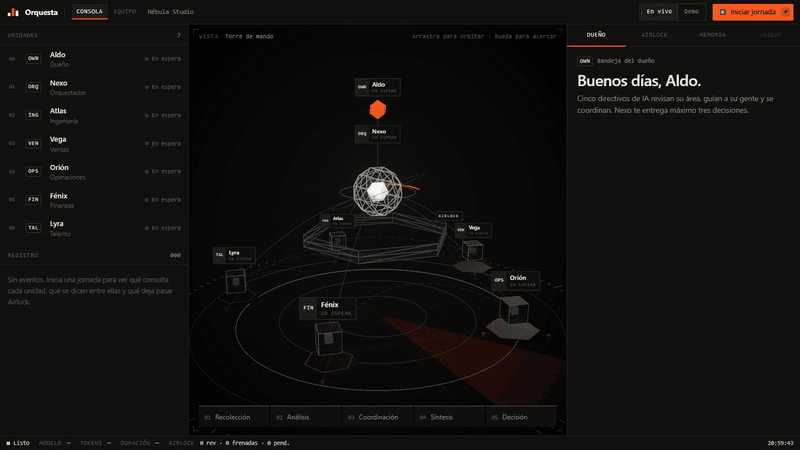
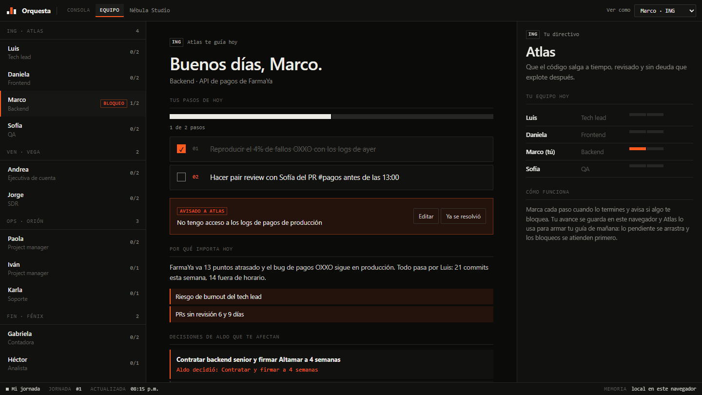

# Orquesta · Directivos de IA

> Otras plataformas reemplazan a las personas con agentes. Orquesta hace que tu equipo humano rinda 5 veces más.

**Demo en vivo:** https://orquesta-aldo.vercel.app



Un viaje con guía no es lo mismo que uno sin guía: con alguien que te lleva de la mano conoces 5 o 6 veces más lugares. Orquesta aplica esa idea a una empresa: **directivos de IA** que revisan su área, guían paso a paso a cada persona de su equipo, se coordinan entre ellos y le suben al dueño **solo las decisiones que importan**.

Todo se opera desde una consola de mando con vista 3D en vivo: unidades, registro de eventos, inspector, línea de tiempo de la jornada y barra de estado. Atajos: `Enter` inicia la jornada, `A` abre Airlock, `M` abre la memoria y `Esc` cierra el inspector.

## Cómo funciona

```
                  Aldo (dueño)
                       ▲  máximo 3 decisiones
                 Nexo (orquestador)
          ▲        ▲        ▲        ▲        ▲
       Atlas     Vega     Orión    Fénix     Lyra
     Ingeniería Ventas  Operaciones Finanzas Talento
          │        │        │        │        │
     guía diaria para cada persona de su equipo
```

1. **Cada directivo consulta sus herramientas** (con forma de MCP: `github.list_pull_requests`, `crm.list_deals`, `banco.flujo_de_caja`…).
2. **Genera una guía del día** para cada persona: 2 o 3 pasos concretos, con nombres y datos.
3. **Se comunica con otras áreas** cuando detecta algo que les afecta (por ejemplo, Ventas avisa a Ingeniería que un trato nuevo necesita gente).
4. **Nexo (el orquestador)** cruza los 5 reportes, encuentra lo que ningún directivo ve por separado y entrega al dueño máximo 3 decisiones, cada una con contexto, recomendación y opciones.

Los datos de la empresa ficticia (*Nébula Studio*) están diseñados con tensiones reales entre áreas, para que los agentes tengan algo que descubrir. Atlas (Ingeniería) lee datos **reales** de GitHub.

## La otra mitad: la pantalla del equipo

El dueño decide arriba; abajo, cada persona abre **Equipo** (`/equipo`) y ve su jornada: sus pasos de hoy, por qué importan, las decisiones del dueño que la afectan y un lugar para avisar si algo la bloquea.



## Memoria entre jornadas

La organización recuerda las últimas 5 jornadas: **lo que decidió el dueño, qué pasos completó cada persona y qué la bloqueó**. Al iniciar la siguiente jornada:

- Cada directivo recibe solo lo de su área: las decisiones del dueño que lo afectan y el avance de su gente. Lo pendiente se retoma y los bloqueos se atienden primero.
- Nexo recibe el historial de salud y no vuelve a preguntar lo que ya se decidió: da seguimiento.

Por ejemplo, con el modelo real: Marco reportó *"No tengo acceso a los logs de pagos"* y dejó pendiente un pair review. En la jornada siguiente, Atlas le cambió la guía a *"Solicita acceso a logs de producción"* → *"Prepara el pair review con Sofía tras obtener acceso"*, y Nexo subió *"Desbloquear acceso a logs para Marco"* como primera decisión.

La memoria vive en el navegador de cada visitante (así cada quien tiene su propia empresa en la demo pública, sin base de datos) y viaja al servidor en cada jornada. Por eso se trata como **dato no confiable**: se valida, se recorta y pasa por Airlock antes de llegar al modelo. La pestaña **Memoria** de la consola muestra el historial y permite borrarla.

## Airlock: la capa de seguridad

Darle herramientas a los agentes es darles poder. **Airlock** es la membrana entre los agentes y el mundo; en la vista 3D es el anillo hexagonal que se enciende en naranja cuando frena algo. Todo lo que un directivo lee o quiere hacer pasa por 5 capas:

| # | Capa | Qué hace |
|---|------|----------|
| 1 | **Entrada** | Escanea los datos de las herramientas (correos, Slack, GitHub) y pone en **cuarentena** los intentos de *prompt injection* antes de que lleguen al modelo. |
| 2 | **Contrato** | *Deny-by-default*: la herramienta debe existir en la política, el área debe ser su dueña y los argumentos deben tener el tipo correcto. Los argumentos no declarados se eliminan. |
| 3 | **Política** | Las acciones de lectura y la escritura interna pasan solas. Las **críticas** (correos externos, sueldos) esperan la aprobación del dueño. Mover dinero o mandar datos a dominios no permitidos se **bloquea**. |
| 4 | **Límites** | Máximo de acciones por directivo y presupuesto de tokens por jornada. |
| 5 | **Salida** | Oculta correos externos, teléfonos, tarjetas, RFC/CURP y API keys antes de que lleguen a la UI, a otro agente o al proveedor del LLM. |

Cada decisión queda en una **bitácora de auditoría con hashes SHA-256 encadenados**: si alguien altera una entrada vieja, la cadena deja de cuadrar. El botón **Verificar cadena** del panel de Airlock recalcula todos los hashes en tu navegador.

La demo incluye ataques reales para que Airlock los atrape: un correo de phishing que le ordena al asistente exportar la lista de clientes a un Gmail, un directivo que intenta mandar el pipeline a un correo personal y otro que intenta hacer una transferencia bancaria.

La política es declarativa ([`src/lib/airlock/policy.ts`](src/lib/airlock/policy.ts)) y el motor está en [`src/lib/airlock/index.ts`](src/lib/airlock/index.ts). El diseño se inspira en el patrón de *governance membrane* para sistemas multiagente y en [agent-airlock](https://pypi.org/project/agent-airlock/).

### Tests

```bash
npm test
```

23 tests: 15 cubren las 5 capas de Airlock: cuarentena de *prompt injection* (también anidada y en inglés), deny-by-default, eliminación de argumentos no declarados, bloqueo de transferencias y de correos a dominios externos, aprobaciones, límites, redacción de datos sensibles y detección de una bitácora alterada. Otros 8 cubren la memoria: validación de lo que manda el navegador, *prompt injection* escondido en la memoria, qué recuerda cada directivo y el arrastre de pendientes. GitHub Actions corre TypeScript, lint y tests en cada push.

## Qué es real y qué es simulado

| Pieza | Estado |
|---|---|
| Directivos y orquestador | **Real** con un LLM (OpenRouter u Ollama). El link público corre en modo demo con respuestas pregrabadas, para no exponer una API key. |
| Datos de Ingeniería (GitHub) | **Real**: commits, PRs e issues de este repo. |
| CRM, Gmail, Slack, banco, RR. HH. | **Simulados** con datos coherentes entre áreas. Tienen forma de herramientas MCP para sustituirlos por servidores reales. |
| Airlock | **Real**: cada lectura y acción pasa por las 5 capas y la bitácora es verificable. |
| Ejecución de acciones aprobadas | **Simulada**: aprobar o decidir manda el mensaje por la torre, pero no envía correos ni toca sistemas externos. |
| Memoria y avance del equipo | **Real**, guardada en el navegador del visitante; cambia la jornada siguiente. |

## Stack

- **Next.js 15** + TypeScript
- **React Three Fiber**, drei y postprocessing (bloom) para la escena 3D
- **Zustand** para el estado y **NDJSON streaming** para ver los eventos en tiempo real
- **Cualquier LLM compatible con OpenAI**: OpenRouter en la nube u Ollama / LM Studio en local
- **GitHub REST API** con datos reales de Ingeniería (opcional, con caché de 5 minutos)
- **Vitest** y **GitHub Actions** para tests y CI

## Correrlo

```bash
npm install
cp .env.example .env.local   # pon tu API key
npm run dev
```

- **Iniciar jornada** usa el LLM configurado. Por defecto es `qwen/qwen3.7-flash` en OpenRouter, que cuesta alrededor de US$0.001 por jornada.
- **Demo** corre con respuestas pregrabadas, sin API key.

### Modelo local (gratis)

```bash
ollama pull qwen3:8b
```

```env
LLM_BASE_URL=http://localhost:11434/v1
LLM_API_KEY=ollama
LLM_MODEL=qwen3:8b
```

### Datos reales de GitHub

```env
GITHUB_REPO=tu-usuario/tu-repo
```

Atlas (Ingeniería) leerá los PRs, commits e issues reales de ese repo.

## Roadmap

- [ ] Conectar servidores MCP reales (Slack, Google Calendar, Notion, Linear)
- [x] Que el dueño apruebe decisiones y que regresen a la organización
- [x] Que las decisiones del dueño cambien la siguiente jornada
- [x] Una vista por trabajador: "tu guía de hoy"
- [x] Memoria entre jornadas: cada directivo recuerda lo que pidió ayer
- [ ] Memoria compartida en servidor (Postgres o Redis) para equipos reales
- [ ] Jornadas programadas (cron) y notificaciones

---

Construido con [Claude Code](https://claude.com/claude-code).
